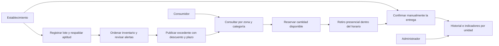
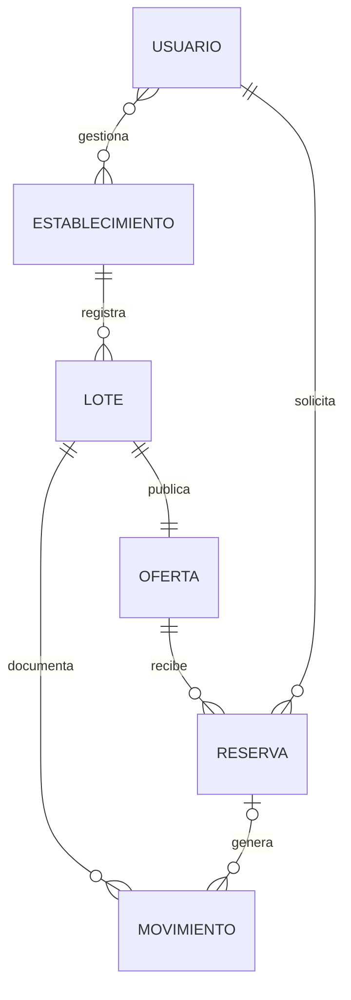

# Matriz de trazabilidad y diseño conceptual

Fuente de alcance: **Informe Segundo Entregable**, septiembre de 2026, apartados 3, 4, 5, 6 y 8. La revisión del original antecede a la implementación. Este documento organiza la propuesta; no cambia los objetivos del informe ni atribuye resultados de campo a la demostración.

## Problema y objetivos

| Situación problemática del informe | Objetivo específico | Módulo visible | Evidencia en la demostración |
| --- | --- | --- | --- |
| Identificación y comercialización tardías de excedentes perecederos | Identificar tempranamente productos próximos a terminar su período comercial | Panel y alertas por lote | Avisos según ventana configurable, límite real y bloqueo de ofertas finalizadas |
| Registro y rotación inadecuados del inventario | Gestionar y seguir lotes por ingreso y fechas aplicables | Inventario | Registro de lote, orden PEPS independiente del orden por límite, existencias y movimientos |
| Comunicación inoportuna entre locales y consumidores | Publicar, consultar y reservar excedentes | Catálogo, detalle y reservas | Consulta por zona, precio, cantidad, horario, reserva y retiro confirmado manualmente |

## Cobertura del alcance

| Alcance del apartado 5 | Estado para el jueves | Implementación posterior |
| --- | --- | --- |
| Registro y autenticación de tres perfiles | Selector explícito de vistas de demostración | Supabase Auth y permisos reales, con rol administrador asignado de forma controlada |
| Publicación con nombre, descripción, cantidad, precio, entrega y límite | Interactivo, con datos ficticios | Persistencia compartida y permisos por establecimiento |
| Lotes y fechas alimentarias | Interactivo | Revisión de campos con participantes del piloto |
| Inventario y PEPS | Interactivo | Movimientos transaccionales y auditoría del servidor |
| Alertas preventivas según vida útil | Visibles dentro del panel | Ejecución persistente y evaluación de canales de notificación |
| Gestión de descuentos | Interactivo; reservas existentes conservan su precio | Historial persistente por usuario y establecimiento |
| Consulta por zona/ubicación registrada | Zonas y direcciones ficticias | Direcciones de participantes verificadas; GPS/mapas no son requisito de esta demo |
| Reserva y retiro confirmado manualmente | Interactivo | Control de concurrencia y verificación del usuario en el servidor |
| Historial de publicaciones, reservas, entregas y cancelaciones | Interactivo y persistente en navegador | Auditoría compartida y respaldo |
| Reportes básicos | Indicadores simulados y CSV por unidad | Datos de campo y evaluación de aprovechamiento |
| Pruebas funcionales | Dominio y recorridos automatizados de navegador | Pruebas de servidor, permisos y concurrencia |
| Piloto con voluntarios | Protocolo preparado, sin resultados inventados | Reclutamiento, consentimiento, ejecución y análisis |

## Actores y recorrido

La demo también permite cancelar una reserva o registrar que terminó sin retiro. Cancelar libera existencias una sola vez; una oferta fuera de plazo permanece cerrada.

## Modelo conceptual

Lote, oferta, reserva y movimiento ya están representados por tipos TypeScript. Usuario y su relación con los establecimientos son parte del diseño futuro y todavía no se implementan como cuentas reales.

- **Establecimiento:** tipo, zona y dirección de retiro.
- **Lote:** alimento, descripción, categoría, unidad, cantidad inicial/disponible, ingreso, tipo y fecha alimentaria, límite comercial, ventana de retiro, anticipación de alerta y declaración del oferente.
- **Oferta:** lote asociado, precio habitual, precio de oferta, publicación, imagen ilustrativa y pausa.
- **Reserva:** código, oferta, cantidad, precio registrado al reservar, estado y fechas de creación/cierre.
- **Movimiento:** lote, reserva cuando corresponda, tipo de operación, cantidad, fecha y descripción.

Para esta versión, un lote representa exclusivamente el excedente publicado y tiene una sola oferta. El sistema no administra toda la compra, elaboración o venta habitual del establecimiento.

## Criterios para interpretar indicadores

Las cantidades de kg, unidades y porciones se muestran por separado. Se filtran las ofertas por fecha de publicación y se consulta el estado actual de las reservas asociadas. No se suman cancelaciones como si fueran nueva producción ni se considera una reserva pendiente como entrega.

La proporción retirada se calcula dentro del mismo conjunto y unidad. Para comparaciones entre productos, unidades como paquetes o porciones requieren describir su contenido. No se convierte una porción a kg sin un factor medido y documentado. Las cifras de esta entrega son ejemplos; no permiten estimar un efecto real de la plataforma.
