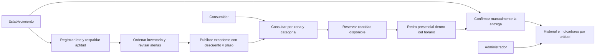
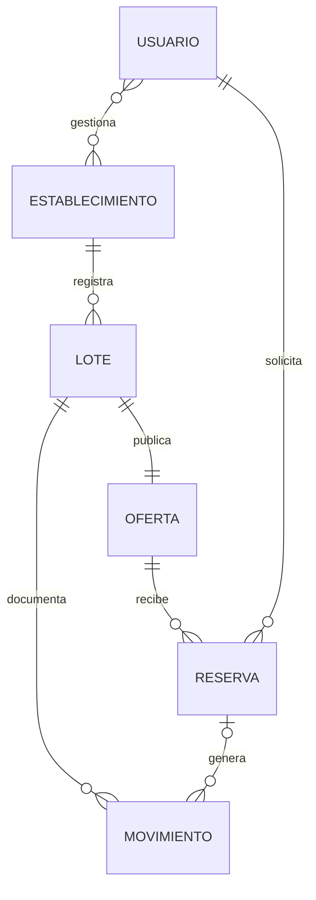

# Matriz de trazabilidad y diseño conceptual

Fuente de alcance: **Informe Segundo Entregable**, septiembre de 2026, apartados 3, 4, 5, 6 y 8. La revisión del original antecede a la implementación. Este documento organiza la propuesta; no cambia los objetivos del informe ni atribuye resultados de campo a la demostración.

## Problema y objetivos

| Situación problemática del informe | Objetivo específico | Módulo visible | Evidencia en la demostración |
| --- | --- | --- | --- |
| Identificación y comercialización tardías de excedentes perecederos | Identificar tempranamente productos próximos a terminar su período comercial | Panel y alertas por lote | Avisos según ventana configurable, límite real y bloqueo de ofertas finalizadas |
| Registro y rotación inadecuados del inventario | Gestionar y seguir lotes por ingreso y fechas aplicables | Inventario | Registro de lote, orden PEPS independiente del orden por límite, existencias y movimientos |
| Comunicación inoportuna entre locales y consumidores | Publicar, consultar y reservar excedentes | Catálogo, detalle y reservas | Consulta por zona, precio, cantidad, horario, reserva y retiro confirmado manualmente |

## Cobertura del alcance

| Alcance del apartado 5 | Implementación | Dónde verlo |
| --- | --- | --- |
| Registro y autenticación que diferencie establecimientos, consumidores y administradores | Cuentas con rol (`consumidor`, `establecimiento`, `administrador`), contraseñas scrypt, sesión en cookie `httpOnly`, guardas por rol en servidor | `/registro`, `/negocios/unirse`, `/ingresar`, menú de cuenta; `/admin/usuarios` |
| Publicación con nombre, descripción, cantidad, precio, condiciones de entrega y tiempo límite | Asistente de 5 pasos con validación por paso y en servidor | Panel → «Publicar excedente» |
| Registro de lotes con ingreso, consumo preferente o vencimiento | Tipo y fecha del alimento + fecha de ingreso por lote | Paso «Fechas del lote»; inventario |
| Inventario ordenado por ingreso (PEPS) | Orden PEPS u orden por fecha límite; existencias disponibles/publicadas | `/panel/inventario` |
| Alertas preventivas según la vida útil | Anticipación configurable por lote (30 min a 24 h); tarjeta «A tiempo de aprovechar» y contador en el menú | `/panel` |
| Gestión de descuentos | Editar precio con descuento en vivo; pausar/reactivar; las reservas conservan su precio | Inventario → editar precio |
| Consulta de ofertas por zona o ubicación registrada | Filtros por zona, categoría, búsqueda, orden y «próximas a su límite»; directorio de locales por zona | `/ofertas`, `/establecimientos` |
| Reserva y confirmación manual del retiro | Reserva transaccional (sin sobre-reservas), código, cancelación; confirmación por el establecimiento | Detalle de oferta, `/mis-reservas`, `/panel/reservas` |
| Historial de publicaciones, reservas, entregas y cancelaciones | Movimientos persistentes con filtros, búsqueda, paginación y CSV | `/panel/historial`, `/admin/historial` |
| Reportes de cantidades publicadas, reservadas y entregadas | Indicadores por unidad, proporción retirada, filtros y CSV | `/panel/indicadores`, `/admin` |
| Pruebas funcionales | Dominio (`npm test`), reglas SQL (`npm run test:db`), recorridos y accesibilidad (`npm run test:e2e`) | `tests/` |
| Piloto con voluntarios | Protocolo preparado; sin resultados inventados | `docs/protocolo-piloto.md` |

## Actores y recorrido

La demo también permite cancelar una reserva o registrar que terminó sin retiro. Cancelar libera existencias una sola vez; una oferta fuera de plazo permanece cerrada.

## Modelo conceptual

Todas las entidades están en Supabase (`supabase/migrations`). Cada cuenta de establecimiento gestiona un único local; la administración puede revisar cualquiera.

- **Usuario:** nombre, correo, teléfono, rol, establecimiento (solo para el rol establecimiento) y contraseña cifrada.

- **Establecimiento:** tipo, zona y dirección de retiro.
- **Lote:** alimento, descripción, categoría, unidad, cantidad inicial/disponible, ingreso, tipo y fecha alimentaria, límite comercial, ventana de retiro, anticipación de alerta y declaración del oferente.
- **Oferta:** lote asociado, precio habitual, precio de oferta, publicación, imagen ilustrativa y pausa.
- **Reserva:** código, oferta, cantidad, precio registrado al reservar, estado y fechas de creación/cierre.
- **Movimiento:** lote, reserva cuando corresponda, tipo de operación, cantidad, fecha y descripción.

Para esta versión, un lote representa exclusivamente el excedente publicado y tiene una sola oferta. El sistema no administra toda la compra, elaboración o venta habitual del establecimiento.

## Criterios para interpretar indicadores

Las cantidades de kg, unidades y porciones se muestran por separado. Se filtran las ofertas por fecha de publicación y se consulta el estado actual de las reservas asociadas. No se suman cancelaciones como si fueran nueva producción ni se considera una reserva pendiente como entrega.

La proporción retirada se calcula dentro del mismo conjunto y unidad. Para comparaciones entre productos, unidades como paquetes o porciones requieren describir su contenido. No se convierte una porción a kg sin un factor medido y documentado. Las cifras de esta entrega son ejemplos; no permiten estimar un efecto real de la plataforma.
